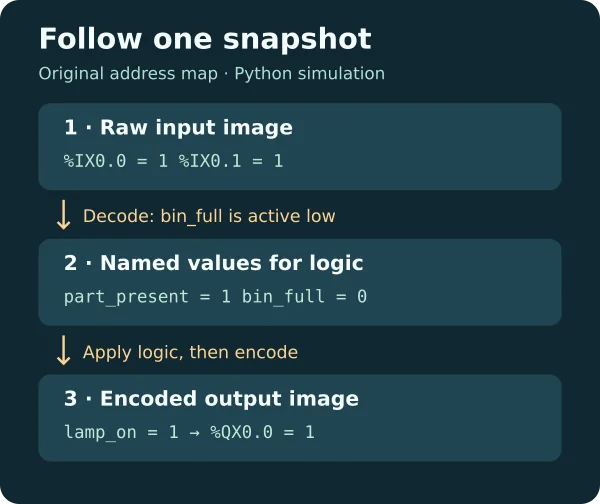
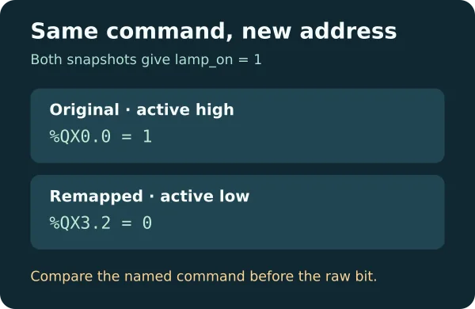

# PLC I/O Mapping: Remap Digital Signals in Python

Replay one digital input snapshot and see how it becomes named inputs, a desk lamp command, and output bits. Compare two maps with the same logic, then reject an invalid map before it produces an output. This is an offline model. It does not communicate with any PLC or drive hardware.

Full lesson: [PLC I/O Mapping on WIFA Robotics](https://wifarobotics.com/learn/plc-io-mapping/).

## Start from zero

1. Install [Python](https://www.python.org/downloads/) 3.10 or later. Check `python3 --version` (macOS/Linux) or `py -3 --version` (Windows).
2. On the GitHub project page, select **Code → Download ZIP**. Extract the ZIP, then open a terminal in the folder containing `io_map.py`.
3. Run the commands below. On Windows replace `python3` with `py -3`. No pip packages, vendor software, or network access are needed to run the files.

```sh
python3 io_map.py examples/original.json
python3 io_map.py examples/remapped.json
python3 io_map.py examples/full-bin.json
python3 io_map.py examples/duplicate.json
python3 -m unittest discover -s tests -v
```

| Example | Named lamp command | Raw output |
| --- | --- | --- |
| Original | `lamp_on = 1` | `%QX0.0 = 1` |
| Remapped and active low | `lamp_on = 1` | `%QX3.2 = 0` |
| Bin full | `lamp_on = 0` | `%QX0.0 = 0` |
| Duplicate input address | No result; exit 2 | No output image |

For the first case, the raw bin bit is `1` and the tag `bin_full` is `0`: the map marks this input active low. In the second case the map also marks the output active low. A logical lamp command of `1` therefore encodes to a raw bit of `0` at the new output address. That is a model assumption about the example interface. It is not a wiring recommendation.





## Files and troubleshooting

- `io_map.py` validates maps, decodes an input snapshot, runs the named logic once, then encodes outputs.
- `examples/` contains three successful snapshots and a deliberately invalid address map.
- `tests/` checks the complete two-input truth table across both maps, bad maps, missing data, output commands and malformed JSON.
- `diagrams/` contains editable SVG and optimized WebP versions of both figures.

If Python cannot open an example, check that the terminal is in the extracted folder. For a missing or unexpected address, compare the map with the input snapshot before changing the logic. Use integer `0` or `1` for raw bits and JSON `true` or `false` for `active_low`. To see a real behavioral difference, copy `original.json` and set only the raw bin input to `0`; the named bin becomes full and the lamp command drops.

## Scope

The address grammar uses an example byte-oriented notation, with only canonical bit addresses accepted. It does not model analog data, word overlaps, scan timing, fieldbus transfers, electrical behavior, or a safety function. Do not use this model to assign actual hardware addresses or to force live outputs. See the [CODESYS I/O Mapping editor](https://content.helpme-codesys.com/en/CODESYS%20Development%20System/_cds_edt_device_io_mapping.html) and [Siemens S7-1200 process image](https://docs.tia.siemens.cloud/r/en-us/v20/functional-description-of-s7-1200-cpus-s7-1200/memory-areas-s7-1200/system-memory-areas-s7-1200/process-image-input/output-s7-1200/basic-principles-of-process-images-s7-1200) for device-specific behavior.
